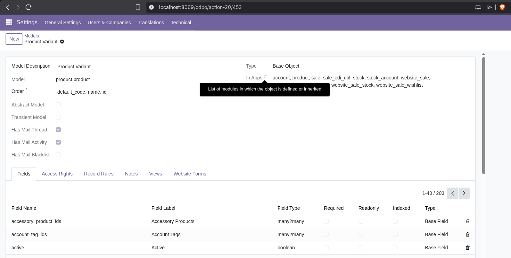

# Odoo's API
Everything here is taken from [Odoo API Documentation](https://www.odoo.com/documentation/18.0/developer/reference/external_api.html#connection)

- Odoo uses `XMLRPC` protocol
- We do that by postfixing '/xmlrpc/2/common' to our URL ('http://localhost:8069')
- **Only the following credentials are needed:** 
  - username: senen.marques@live.u-tad.com (it was accidentally named that instead of 'admin')
  - password:, admin
  - database_name: odoo
  - database_password: admin

# Some useful info
We want to base our MCP tools around products/services ... there are 3 Apps where we can manage products/stock. Those 3 Apps are:

- Inventory
- Sales
- ECommerce
- Website

All three are connected to the same DB tables that handle products, the `product` family of models (DB Tables).
The most important of these tables is `product.product` and its parent model `product.template`.

If you want to verify this, you can naviagte to `Settings` > `Technical` > `Models` and you will see a list of DB Tables (models).
You can search for `product` family of models, and click on `product.product` or `product.template` and see which Odoo Apps (modules) use it

## Using the API
Its fairly simple, although the queries take some learning, for more advanced stuff, see [Odoo API: Calling Methods](https://www.odoo.com/documentation/18.0/developer/reference/external_api.html#calling-methods)

## GET API KEY
Newer versions of Odoo use an API Key and a more RESTful interface
Go to: `User > My Preferences > Security > Add API Key`
**HOWEVER** There is no need for that, we are using the 'XMLRPC' protocol, as we will see going forward
